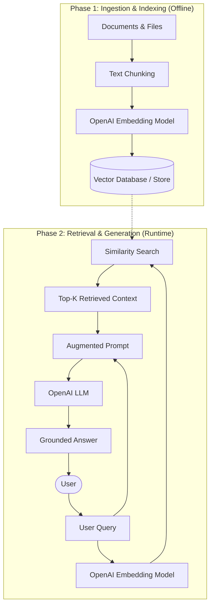

# Retrieval-Augmented Generation (RAG) Architecture

This document explains the architecture and lifecycle of a Retrieval-Augmented Generation (RAG) system using OpenAI models.

> **Tip:** You can also open [**`rag_diagram.html`**](rag_diagram.html) in your browser to view the interactive diagram with full dark-mode styling.

---

## 1. High-Level Architecture Diagram



---

## 2. Text / ASCII Architecture Flow

```text
[PHASE 1: INGESTION & INDEXING]
Raw Documents ────► Text Chunking ────► Embedding Model (OpenAI) ────► Vector Store
                                                                             │
[PHASE 2: RETRIEVAL & GENERATION]                                            │
User Query ───────► Embedding Model ──► Similarity Search (Cosine) ◄─────────┘
   │                                         │
   │                                         ▼
   └──────────────────────────────────► Augmented Prompt ────► LLM ────► Grounded Answer
```

---

## 3. Core Phases Explained

### Phase 1: Ingestion & Indexing (Preparation)
1. **Document Loading**: Source documents (PDFs, Markdown files, web pages, databases) are collected.
2. **Text Chunking**: Content is broken into smaller chunks (e.g., 200–500 tokens) so embeddings retain precise semantic meaning.
3. **Embedding Generation**: Chunks are sent to OpenAI's embedding model (`text-embedding-3-small`) to produce high-dimensional vectors.
4. **Vector Storage**: The vectors along with the original chunk text and metadata are saved to a vector database (e.g., Chroma, FAISS, Pinecone, or in-memory arrays).

### Phase 2: Retrieval & Augmented Generation (Runtime)
1. **Query Embedding**: The user's input query is converted into an embedding using the same model.
2. **Similarity Search**: Cosine similarity compares the query vector against stored vectors to fetch the **Top-$k$** closest passages.
3. **Prompt Augmentation**: The retrieved passages are injected into the prompt template alongside the user's question and system instructions.
4. **LLM Generation**: The LLM (`gpt-4o`, `gpt-4o-mini`) generates a grounded, context-aware answer based on the provided reference material.

---

## 4. Related Code
See [`rag_demo.py`](rag_demo.py) for a working Python implementation of this pipeline using the OpenAI SDK.
